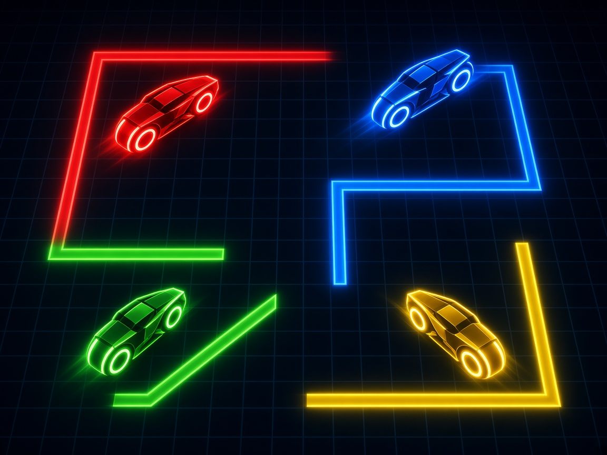

# Light Cycle Quad

Four light cycles, one shared screen, no accounts and no network. Every rider leaves a solid trail. Walls and trails eliminate you. Pickups bend the rules for a moment: a speed boost, a gap in your own trail, or a jump over a single cell. Last cycle riding takes the round. If the riders still in it all crash on the same tick, the round is a draw. First to 5 rounds wins the match.

Play it solo against bots, or with four people on one keyboard (and any gamepads you plug in).

## Launch

The game is a static page. The launchers start a tiny Python 3 server on `127.0.0.1` port **8806** (or the next free port) and open your browser. Nothing is downloaded.

| Platform | How |
| --- | --- |
| macOS | Double-click `launch-mac.command` |
| Windows | Double-click `launch-windows.bat` |
| Linux | `chmod +x launch-linux.sh` and run `./launch-linux.sh` |

From a terminal, in this folder:

```bash
python3 server.py
```

If Python 3 is missing, the launcher says so and points at [python.org](https://www.python.org/downloads/). Pass `--no-browser` to serve without opening a window, or `--port` to try a different port first.

There is no build step and no CDN. The page works offline once the files are on disk.

## Controls

Keyboard seats work with no gamepad. A connected gamepad in slot 0–3 takes over that player (left stick or D-pad to steer, A action, B secondary, Start to pause) until it is unplugged.

| Player | Move | Action | Secondary |
| --- | --- | --- | --- |
| P1 | W A S D | F | G |
| P2 | Arrow keys | `/` | `.` |
| P3 | I J K L | `;` | `'` |
| P4 | Numpad 8 4 5 6 | Numpad 0 | Numpad Enter |
| Gamepad | Left stick / D-pad | A | B |

Turns are 90 degrees only. A reverse press is ignored. Num Lock should be on for P4.

| Key | What it does |
| --- | --- |
| Enter / Start | Leave the title, start the match, confirm menus, skip the round banner, rematch |
| Esc / Start | Pause during a round. Esc also backs out of menus |
| M | Mute |

On the join screen, **action** claims that seat for a human. **Secondary** cycles an empty seat between bot and off. At least two cycles (humans or bots) are required. Empty seats default to bots, so one person can play immediately after joining.

Pause opens Resume, Settings, and Quit. Settings cover volume, mute, the round target (1, 3, 5, 7, or 10), and a remap screen. Bindings and settings are stored in `localStorage` under `lightcyclequad.bindings` and `lightcyclequad.settings`.

Connected pads show a small icon on the join screen and the HUD, including when a pad is plugged in mid-match.

## Rules

The arena is a grid. Each cycle moves one cell at a time and paints the cell it leaves. Hitting a wall, a trail, another rider, or landing on a cell somebody else enters on the same tick is an elimination. Jumping skips the next cell (trail and all) and lands on the one after; the landing cell still has to be empty and inside the arena.

| Pickup | Effect |
| --- | --- |
| Boost | Step interval is cut in half for a short time |
| Gap | For a short time the cycle leaves no trail, so others can cross that path |
| Jump | The next step hops two cells, clearing one obstacle |

## Scoring

- A round ends when fewer than two cycles from that round are still alive.
- One survivor scores 1 point.
- Zero survivors (everyone still in the round crashed together) is a draw. Nobody scores.
- The match ends when a player reaches the round target, 5 by default.
- Standings stay up for a rematch or a return to the title. The match seed is shown there; the same seed replays the same pickups and bot tie-breaks.

## arcade.json

`arcade.json` is the Arcade OS manifest: display name, id `lightcyclequad`, cover and icon paths, per-platform launch commands, web entry `index.html`, 4 player slots, minimum 1 human at the machine, keyboard and gamepad input, version `1.0.0`, and port `8806`.

## Tests

Core rules live in `src/core/` with no DOM, so Node's built-in test runner can drive them. UI, input wiring, and synthesized audio live in `src/ui/`.

```bash
node --test tests/
python3 tests/smoke_server.py
```

The JavaScript tests cover movement and 90-degree turns, wall and trail collisions, same-cell and head-on crashes, elimination, round and match scoring, draws, boost / gap / jump, seeded RNG, keyboard and mocked gamepad mapping, bots, and that `arcade.json` points at real files. The Python smoke test starts `server.py` with `--no-browser` and checks that `index.html`, the module script, and `arcade.json` are served. GitHub Actions runs both.

## License

MIT. See [LICENSE](LICENSE).
